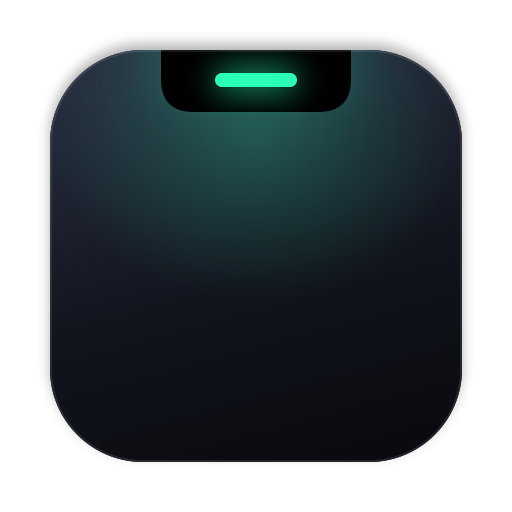
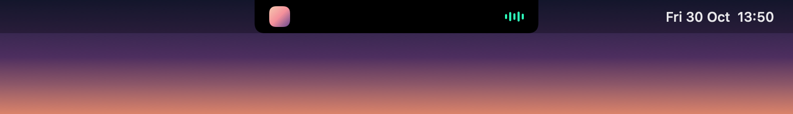
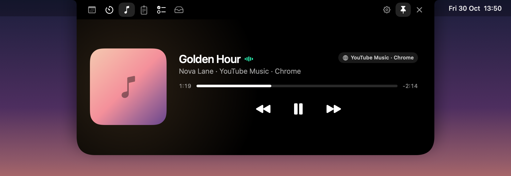
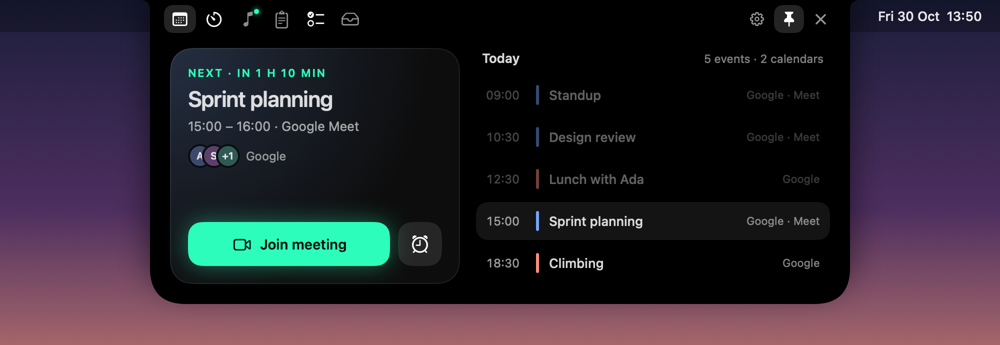
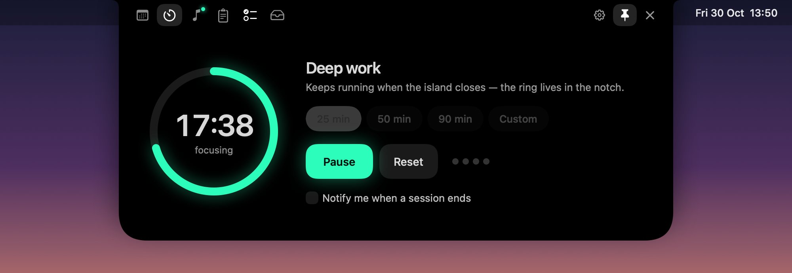
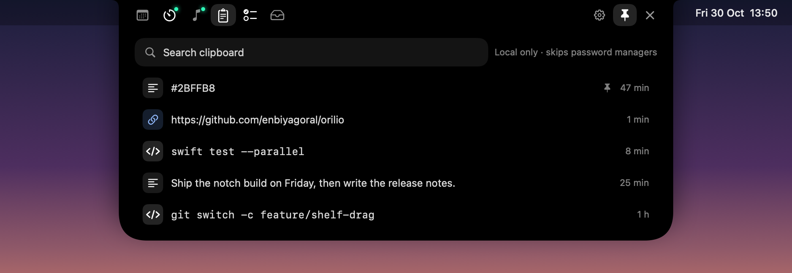
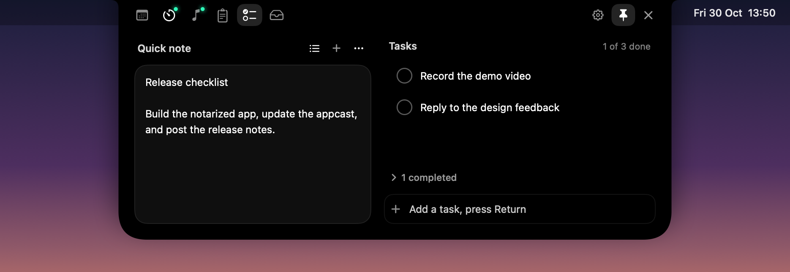
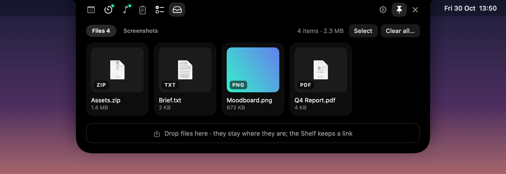
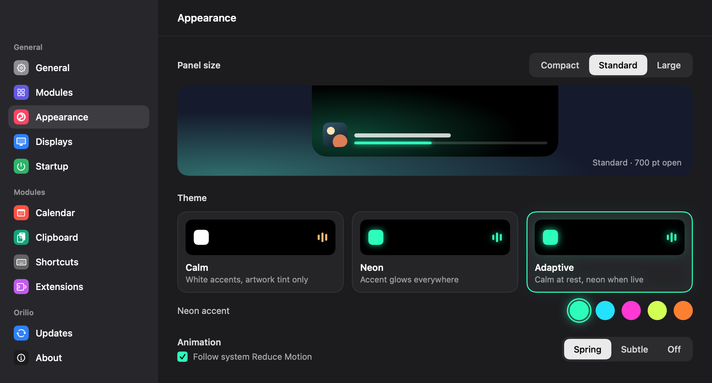
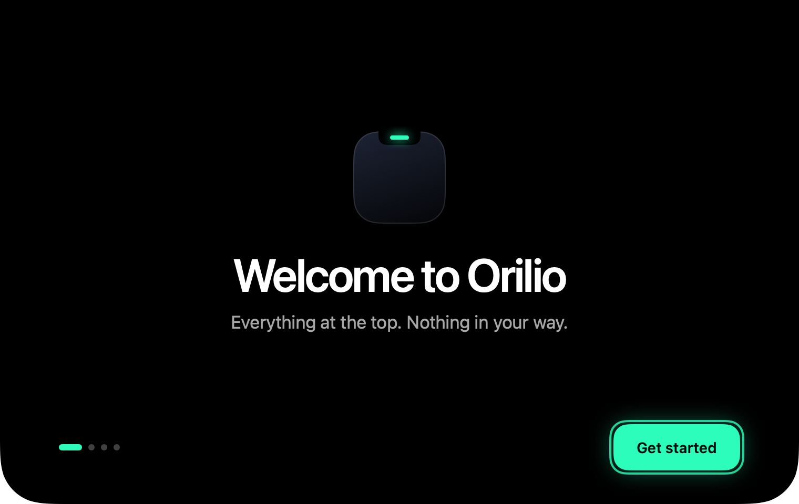

<p align="center">
  
</p>

<h1 align="center">Orilio</h1>

<p align="center">
  A calm control surface for the Mac notch. Music, your day, a focus timer, clipboard, notes and files, one hover away.
  <br>Native, free and open source.
</p>

<p align="center">
  <a href="LICENSE"></a>
  
  
</p>

<p align="center">
  
</p>

<p align="center">
  
</p>

## What's in the notch

<table>
  <tr>
    <td width="50%"></td>
    <td width="50%"></td>
  </tr>
  <tr>
    <td><b>Calendar</b><br>Today's events and the next meeting, with one-click Join for Google Meet, Zoom and Teams.</td>
    <td><b>Focus</b><br>25, 50, 90 minutes or your own. The ring keeps running in the notch when the island closes.</td>
  </tr>
  <tr>
    <td></td>
    <td></td>
  </tr>
  <tr>
    <td><b>Clipboard</b><br>Search, pin and copy back. Kept on this Mac only, and skips password managers.</td>
    <td><b>Notes & Tasks</b><br>A quick note and a short task list, stored on this Mac.</td>
  </tr>
  <tr>
    <td></td>
    <td></td>
  </tr>
  <tr>
    <td><b>Shelf & Screenshots</b><br>Park files on the way to somewhere else, and keep a screenshot library.</td>
    <td><b>Make it yours</b><br>Panel size, Calm, Neon or Adaptive themes, accents, and the modules you want, in your order.</td>
  </tr>
</table>

Also: **Now Playing** for Spotify, Apple Music and browser players (YouTube Music, YouTube, Spotify and SoundCloud in Chrome), a **Camera Mirror**, and **Extensions** that run sandboxed and only show what they're allowed to.

## Built to feel native

- Works with the notch and without it: on an external display the island becomes a floating pill.
- Every module from the keyboard: ⌘1–6 to switch, Esc to close, Space to preview.
- Follows Reduce Motion, VoiceOver labels throughout, Light and Dark settings.
- English and Turkish.

<p align="center">
  
</p>

## Build from source

Requires macOS 14.6 or later and Xcode with Swift 6.

```sh
./scripts/make-app.sh release
open build/Orilio.app
```

Browser players need the extension in `extensions/chrome` and its native host: `scripts/install-chrome-host.sh`.

## License

Orilio is free software: you can redistribute it and/or modify it under the terms of the
GNU General Public License as published by the Free Software Foundation, either version 3
of the License, or (at your option) any later version.

Orilio is distributed in the hope that it will be useful, but WITHOUT ANY WARRANTY; without
even the implied warranty of MERCHANTABILITY or FITNESS FOR A PARTICULAR PURPOSE.
See the [LICENSE](LICENSE) file for details.

Copyright (C) 2026 Enbiya Goral and Orilio contributors.

The "Orilio" name and app icon are not covered by this license — see [TRADEMARK.md](TRADEMARK.md).
